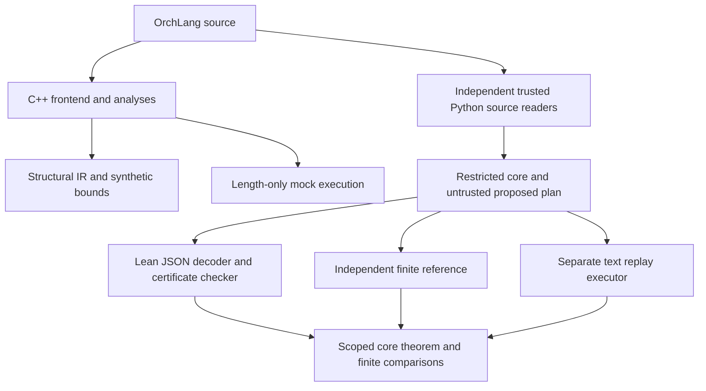

> Historical status for the earlier review snapshot. The current scientific
> revision and evidence are described in [REVISION_STATUS.md](REVISION_STATUS.md).

# OrchLang: complete explanation and publication status

Status date: 24 October 2026. This document describes implemented work and
retained evidence. The [master plan](PUBLICATION_MASTER_PLAN.md) controls
conflicting older research guidance. The author's later instruction waived
waiting for unavailable faculty input; it did not create faculty endorsement.

The result is a compiler/auditing prototype, independent finite executors,
three small mechanized models and a reproducible software-paper draft. It is
not a verified implementation of a cloud service and is not yet an approved
journal submission. The [paper PDF and source snapshots](../publication/README.md)
are review artifacts. Public Git hosting and a permanent archival DOI are
different release milestones.

## 1. Problem, original failure and repair

Workflows containing LLM calls may have bounded resource usage, yet a resource
observation can still depend on secret control flow. A useful analyzer must
distinguish a bound on one execution from a relation between two executions.
The former alone does not establish that observing the bill hides a secret.

The original build passed 95 tests but accepted a workflow with two different
model contracts shadowed under the same local name. At seed 1, changing the
secret Boolean produced 2 versus 987 synthetic resource units. The old name-
based relation conflated distinct contracts. The witness, acceptance message
and both executions are preserved in [the original audit](../research/2026-10-23/README.md)
and [baseline records](../research/implementation-2026-10-23/).

The repaired C++ analysis uses resolved binding identities, canonical abstract
contracts and request-content facts. Equivalent aliases can match; identical
spelling alone cannot. Further regressions cover literal content, shadowing,
public guard resolution, lexical scope, retry signatures, arithmetic overflow,
runtime pin validation, strict numeric options and JSON escaping. The witness
is now rejected with E236. These repairs are tested implementation facts;
there is no general soundness proof for every C++-accepted program.

## 2. Components and trust boundaries

The diagram shows separate paths, not a proved translation from the C++ compiler
to Lean. The [semantics inventory](SEMANTICS.md) gives each component's coverage.

| Component | Implemented role | Boundary that remains |
|---|---|---|
| C++ frontend/checker | Parse/type/policy analysis, synthetic bounds, relational signatures | No full implementation soundness theorem |
| C++ mock interpreter | Offline sampled lengths and resource reports | No response generation, real tokenizer or provider execution |
| Structural baseline | Conventional sum/max/retry-multiply bounds over frontend IR | Shares primitive facts with the compiler; cannot validate those facts independently |
| Finite reference | Text-valued requests/responses, exact rational weights, lexical scope and billed failures | Hand-authored finite core, stateless tables, operational limits |
| Replay executor | Separate choice-tape text execution and exact observation collection | Tested finite conformance; shares contract validation, not execution logic |
| Python source readers | Restricted parsing, lexical resolution, request construction and source/core binding | Trusted parser, slot allocation, JSON and hashing; not mechanized |
| Lean developments | Small-core resource and normalization/certificate theorems | No full source, provider, operating-system or tokenizer theorem |

The C++ `certify` command emits an explicitly labelled analysis report. Use the
separate [closed certificate CLI](CERTIFICATES.md) or
[dataflow certificate CLI](DATAFLOW_CERTIFICATES.md) for the Lean-checked path.
Source hashes detect changes; they are not digital signatures or proof of origin.

## 3. What the formal results mean

[BoundedCore.lean](../proof/BoundedCore.lean) proves a scalar resource bound for
a small nondeterministic language, conditional on primitive-call bounds. It
includes sequence, branch maximum and bounded repetition. The result concerns
one resource unit and does not prove a provider obeys an output cap.

[FiniteRelational.lean](../proof/FiniteRelational.lean) checks normalization of
closed requests and proves equality of weighted trace semantics for every
secret Boolean store when a certificate is accepted. Its executable JSON
acceptance theorem applies to successfully decoded core values.

[DataflowCore.lean](../proof/DataflowCore.lean) adds actual response strings in
a store, so later requests can depend on previous responses. Normalization
preserves the complete state-transformer semantics under shared public inputs
and shared stateless request-indexed finite kernels. Core retries restore the
outer store between attempts, bill all failed attempts and stop on success.

The relational equalities are algebraic. Interpreting weights as probabilities
additionally requires nonnegative, normalized kernels. The executable dataflow
evaluator checks supplied finite tables, but there is no general mechanized
kernel-validity or provider-conformance theorem. Proofs compile with Lean 4.19.0,
without Mathlib, custom axioms or admitted lemmas; printed standard axioms are
documented in [proof/README.md](../proof/README.md).

Two important counterexamples explain the restrictions:

- Requests `yes` and `no!` have equal byte lengths but can have different response
  distributions. Equal input length cannot justify an identity coupling.
- Responses `aa` and `bb` have equal lengths but can produce different next
  requests and therefore different downstream usage. A length-only response
  relation does not establish dataflow correctness.

The account observer receives ordered contract/unit/usage/status events; an
aggregate bill is a projection of that trace. Timing, provider state, tool side
effects and returned text are outside these cost observations. Equal bills do
not authorize disclosure of secret text. Same-seed mock agreement is not a proof
of equal real-world probability distributions.

The source certificate fragments are deliberately smaller than the full language.
Closed certificates exclude inputs and downstream responses. Dataflow certificates
allow public text/Boolean inputs and response bindings, with secret Boolean
control and root literal outputs only. Both reject source retries because the
C++ mock retry failure rule differs from the reference/core rule. Neither checks
the C++ source budget as a real-token or UTF-8-byte budget. See the fragment
manuals for the exact syntax and fail-closed restrictions.

## 4. Evidence, without extrapolation

| Completed observation | Meaning and practical limit |
|---|---|
| 106 C++ tests and 47 Python tests; three Lean files compile | Current local validation, not independent human review |
| 576 generated closed programs; 24 accepted | Zero accepted counterexamples under supplied kernels; no observed precision advantage over trace identity |
| Four compiled semantic mutants detected | Deliberately injected faults, not a comprehensive mutation score |
| 624 closed certificate checks | Includes source/plan tampering and malformed-input rejection |
| 12 replay cases / 48 weighted paths | Finite reference/replay agreement, not an inference adapter theorem |
| 256 dataflow pipelines / 3,072 execution contexts; 16 accepted | One generated two-call-per-arm pipeline shape plus public tail; zero recorded three-way execution disagreements |
| Eight dataflow core boundaries / 23 weighted paths | Additional cases, including retries and downstream-content counterexamples |
| 32 changed sources, 16 altered plans, eight invalid evaluator inputs rejected | Dataflow negative validation; does not prove the source reader |
| 11 authored external cost projections / 220 mock runs | From a 21-candidate census; zero original application executions and zero faithful functional translations |
| 13 of 24 exact tokenizer encodings exceed the byte/divisor estimate; 6 of 10 concatenations are nonadditive | Fixed GPT-2 BPE/BERT WordPiece probes; no population error rate, inference or provider validation |

The C++ checker accepts eight generated dataflow cases and emits E230 in 192.
Its confidentiality/PC-label judgment differs from the separate core's resource
judgment; comparing acceptance counts does not establish a precision ranking.

Read the [23 October records](../research/validated-2026-10-23/README.md),
[24 October records](../research/validated-2026-10-24/README.md),
[protocol amendments](../research/protocol-amendments.md) and
[dataflow development notes](../research/dataflow-development-notes.md).
Failed and incomplete attempts remain retained and explicitly distinguished
from completed runs. These are disclosed development campaigns, not held-out
preregistered studies. No performance superiority, real application coverage or
external adoption is established.

## 5. Reconstructing and checking the work

Start with [REPRODUCIBILITY.md](REPRODUCIBILITY.md). Python-only checks need
Python 3.10+; C++ checks need a usable C++17 compiler; proof checks need Lean
4.19.0. The principal checks use no GPU, model downloads, API keys or network.
Use new output directories outside the checkout when preserving a clean run.

The [publication directory](../publication/README.md) contains the reviewed PDF,
checksums and Git bundles for the exact historical tested revisions. This is
necessary because those manifests cite isolated snapshot commits that are not
ancestors of the main development history. Clone the relevant bundle to
reconstruct them. Do not substitute the current branch SHA in old manifests.

The current manuscript is [editable LaTeX](manuscript/main.tex). Its evidence
tables are generated from the retained raw data, not manually invented values.
The reproduction manual gives exact regeneration commands. Author review and
release checks are in [AUTHOR_REVIEW.md](AUTHOR_REVIEW.md).

The [fresh GitHub-package check](../research/github-validation-2026-10-24/README.md)
records a clean clone of 9f4975e: a fresh C++ build, 106 C++ tests, 47 Python tests
and three Lean files pass. All original evidence hashes and artifact bundles
verify, and manuscript evidence files regenerate byte-identically. This later
check is on the same machine by the same implementer; it does not add independent
review, a new research sample, or cross-platform validation.

## 6. Prior art and contribution

The [literature record](../research/literature.md) and
[novelty ledger](../research/novelty-ledger.csv) distinguish read material from
metadata-only checks and inaccessible sources. Closest comparisons include
Hard-KLAIM, relational/constant-resource analysis, probabilistic resource analysis,
eRHL, PC2 and structural LLM cost tooling. Private library PDFs are not published
in this repository. Source citations and access limits remain documented.

Withdrawn claims include blanket stochastic-AARA impossibility and broad novelty
from merely combining information flow with cost or attaching certificates to
agents. The achieved contribution is a scoped auditing/checking artifact with
explicit counterexamples, repairs, core proofs and reproducible comparisons.
General research novelty and a practical advantage over credible alternatives
remain unestablished. [claims.csv](../research/claims.csv) records 26 exact claims,
their status, assumptions, evidence and open obligations.

## 7. Journal assessment and remaining work

The [wider venue comparison](../research/venue-search-2026-10-24.md) records primary
sources, scope, fee-policy verification limits and route-specific weaknesses.
JORS Software Metapapers and SoftwareX are leading alternatives to SCP OSP for
the achieved artifact. STTT is relevant after realistic integrations. JOSS's
current public-history/research-use gates have not been established for this
project. Journal choice is not approval or an acceptance guarantee.

The most valuable missing evidence is faithful end-to-end application use,
measured integration/reuse effort, defensible benefits over existing tools and
independent reproduction. A small API experiment alone would not establish
novelty, practical significance or privacy. The current paper is honestly scoped
to offline evidence and does not need an API key to reproduce its claims.

Outstanding obligations include trusted source-to-core correspondence,
provider/tokenizer/cap/retry conformance for any future live claim, realistic
evaluation, independent human review, final author approval, accurate affiliation
and competing-interest declarations, and a permanent archival release. Final
author verification is distinct from the owner's authorization to push this
review artifact to GitHub. No manuscript has been submitted and no fee accepted.

Publication charges are separate from the USD 5 API-testing cap. API spend and
reservations remain USD 0. A future paid test requires the offline gates and an
explicitly calculated bounded cost manifest before requesting a restricted key.
Credentials must never enter Git or logs. MIT covers the project software;
the [third-party notices](../THIRD_PARTY_NOTICES.md) cover upstream material and
the separately licensed Elsevier template.

## 8. Documentation map and historical material

| Reader's task | Entry point |
|---|---|
| Build/run the compiler | [README](../README.md), [language specification](LANGUAGE_SPEC.md) |
| Understand guarantees and exclusions | [SEMANTICS](SEMANTICS.md), [proof inventory](../proof/README.md) |
| Issue/check a certificate | [closed fragment](CERTIFICATES.md), [dataflow fragment](DATAFLOW_CERTIFICATES.md) |
| Reproduce experiments/tables | [REPRODUCIBILITY](REPRODUCIBILITY.md), dated evidence READMEs |
| Audit a manuscript assertion | [claim ledger](../research/claims.csv), [novelty ledger](../research/novelty-ledger.csv) |
| Review the paper | [PDF and provenance](../publication/README.md), [LaTeX guide](manuscript/README.md), [author packet](AUTHOR_REVIEW.md) |
| Select a journal | [venue search](../research/venue-search-2026-10-24.md), [SCP checklist](VENUE_CHECKLIST.md) |
| Continue research | [progress log](../research/PROGRESS.md), [master plan](PUBLICATION_MASTER_PLAN.md) |

Older class submissions, benchmark reports, the historical README and the
superseded research brief are retained for provenance. Their stronger claims
must not be treated as current results. The status guide, exact claim ledger and
authoritative master plan explain which claims were repaired, narrowed or
withdrawn. Evidence records preserve their original dates and machine paths;
those paths document provenance and are not required installation locations.
